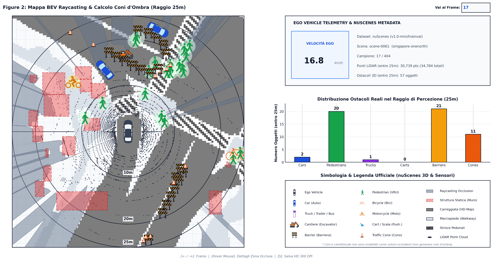
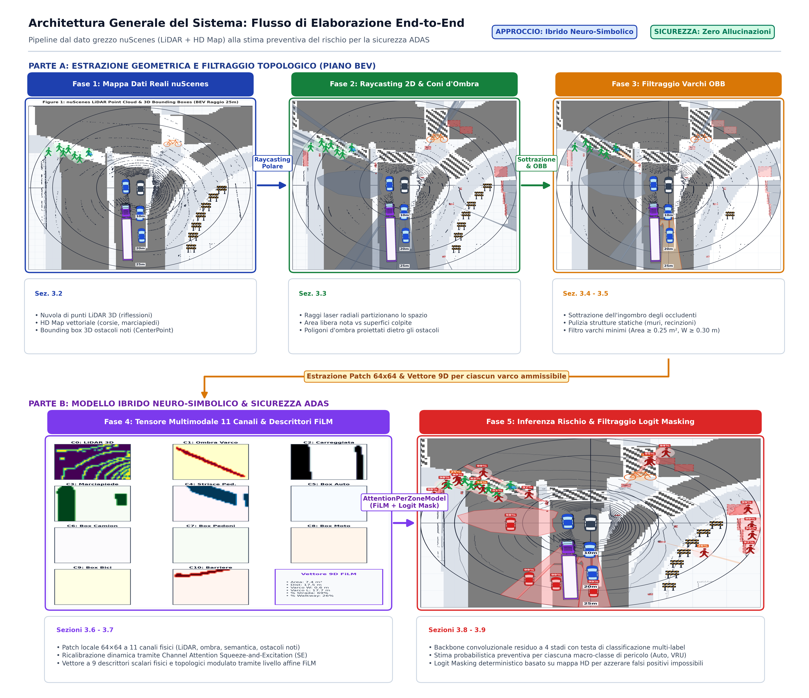
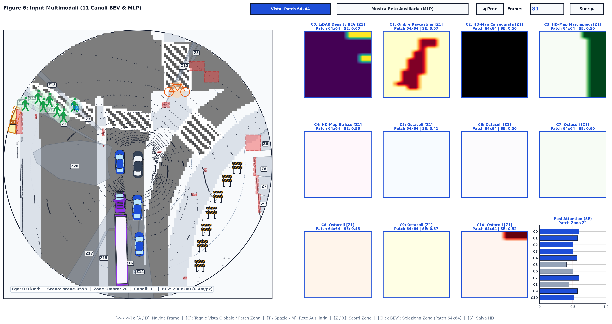
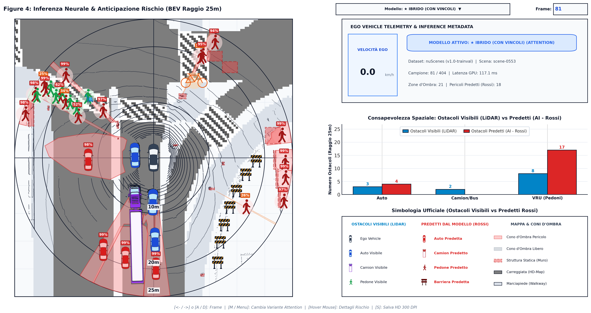
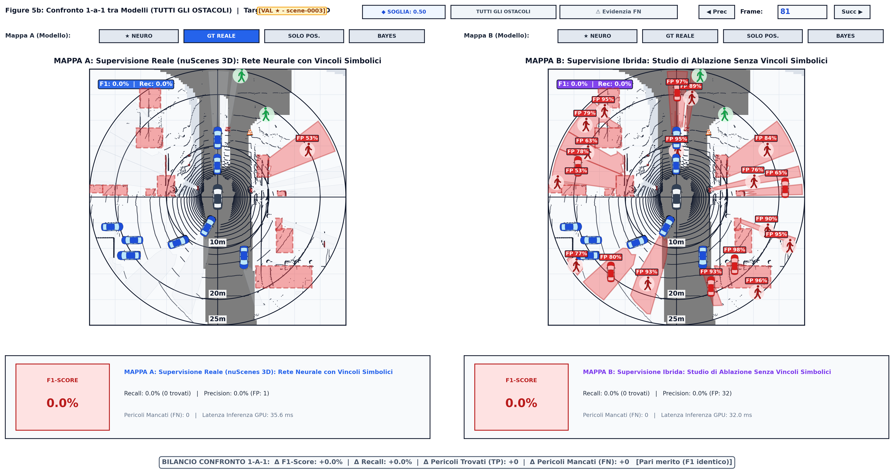
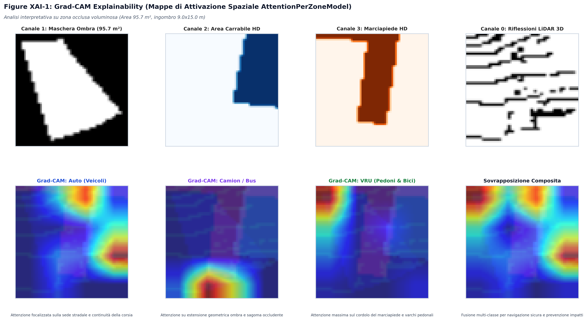
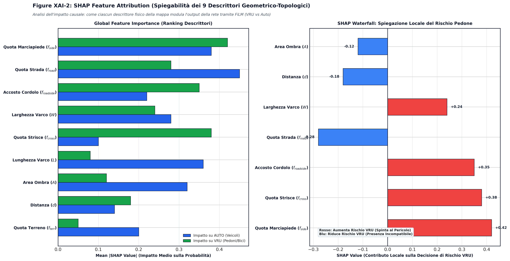

# Occlusion-Mapper: Stima Neuro-Simbolica per la Percezione delle Zone Occluse nella Guida Autonoma

[](https://www.python.org/)
[](https://pytorch.org/)
[](https://www.nuscenes.org/)

Repository ufficiale del progetto di Tesi dedicato alla stima, modellazione probabilistica e inferenza degli ostacoli nascosti nelle zone cieche sensoriali (*Beyond Line-of-Sight*) per veicoli a guida autonoma su dataset **nuScenes**.

---

## 🎯 Il Problema e la Soluzione

I sensori fisici di bordo (LiDAR e telecamere) operano rigorosamente in **linea di vista diretta** (*Line-of-Sight*): ostacoli come veicoli in sosta o edifici schermano completamente la visuale retrostante, generando **coni d'ombra sensoriali**. I sistemi di percezione convenzionali non segnalano alcun pericolo finché l'ostacolo non si rende visibile, riducendo a zero il margine di reazione.

<p align="center">
  
</p>

**Occlusion-Mapper** supera questo limite integrando:
1. **Geometria dell'Ombra (LiDAR 3D)**: raycasting 3D in coordinate polari per identificare con esattezza le aree occluse.
2. **Semantica Stradale (Mappe HD)**: informazione topologica sul piano stradale (corsia, marciapiede, strisce pedonali).
3. **Apprendimento Ibrido Neuro-Simbolico**: una rete convoluzionale guidata da attenzione su canali (*Channel Attention*) e modulazione scalare (*FiLM*), vincolata da regole fisiche deterministiche (che azzerano a priori predizioni incompatibili con la fisica del mondo reale).

---

## 🔄 Architettura della Pipeline End-to-End

Flusso di elaborazione suddiviso nei 5 macro-moduli funzionali:

<p align="center">
  
</p>

```
[ Nuvola LiDAR 3D + HD-Map nuScenes ]
                 │
                 ▼
 1. Space Carving & Raycasting 3D (Bird's-Eye-View 200x200 a 0.4 m/pixel)
                 │
                 ▼
 2. Decomposizione Poligonale & Bounding Box Orientati (Shapely + OBB)
                 │
                 ▼
 3. Estrazione Feature Multimodali per Zona (Patch BEV 11 canali 64x64 + 9 scalari)
                 │
                 ▼
 4. Rete Neurale Attention-per-Zone (Channel Attention + Modulazione FiLM)
                 │
                 ▼
 5. Mascheramento Neuro-Simbolico & Verdetto di Rischio (Auto, Camion/Bus, VRU)
```

<p align="center">
  
</p>

---

## 📊 Risultati Sperimentali e Spiegabilità (XAI)

### 1. Inferenza Neurale e Mappa del Rischio
Stima probabilistica per zona e visualizzazione intuitiva delle probabilità di classe:

<p align="center">
  
</p>

### 2. Confronto Sperimentale: Neuro-Simbolico vs Pura Rete Neurale
L'applicazione dei vincoli deterministici elimina sistematicamente i falsi allarmi fisicamente impossibili:

<p align="center">
  
</p>

### 3. Spiegabilità con Grad-CAM e Valori di Shapley (SHAP)
Verifica della focalizzazione visiva dei filtri convoluzionali e dell'attribuzione di importanza dei 9 descrittori scalari topologici:

<p align="center">
  
  
</p>

---

### Metodo 1: Con Conda (Consigliato per PC Laboratorio / Server GPU / Linux)
```bash
# Creazione e attivazione ambiente da file environment.yml
conda env create -f environment.yml
conda activate occlusion-mapper
```

### Metodo 2: Con Python venv (Standard / Windows)
```powershell
python -m venv .venv
.\.venv\Scripts\Activate.ps1
pip install -r requirements.txt
```


---

## 🚀 Comandi Principali di Esecuzione

### A. Run Completa da Zero (Pipeline End-to-End)
Esegue l'intero flusso dall'estrazione geometrica alla valutazione finale:

```powershell
# 1. Estrazione varchi occlusi via raycasting 3D (8 worker paralleli)
.\.venv\Scripts\python.exe estrazione_zone_occluse.py --workers 8

# 2. Addestramento modello proposto (Ibrido Neuro-Simbolico)
.\.venv\Scripts\python.exe addestramento/train_per_zone_attention.py --mode hybrid --split train --workers 8

# 3. Calibrazione fine delle soglie decisionali (F1-score)
.\.venv\Scripts\python.exe valutazione/calibra_soglie.py

# 4. Benchmark e valutazione ufficiale (split validazione: 6.019 frame inediti)
.\.venv\Scripts\python.exe valutazione/evaluate_final_official.py --mode hybrid --split val
```

---

### B. Run Rapida: Solo Modello Ibrido Proposto
```powershell
# Addestramento
.\.venv\Scripts\python.exe addestramento/train_per_zone_attention.py --mode hybrid

# Valutazione
.\.venv\Scripts\python.exe valutazione/evaluate_final_official.py --mode hybrid --split val
```

---

### C. Studio di Ablazione & Altri Modelli
```powershell
# Modello Puro Neurale (senza vincoli neuro-simbolici)
.\.venv\Scripts\python.exe addestramento/train_per_zone_attention.py --mode pure_neural

# Baseline addestrata su GT Reale 3D
.\.venv\Scripts\python.exe addestramento/train_per_zone_attention.py --mode real

# Valutazione comparativa di tutti i modelli insieme
.\.venv\Scripts\python.exe valutazione/evaluate_final_official.py --mode all --split val
```

---

### D. File Generati in Automatico al Termine della Valutazione
* **`documentazione/RISULTATI_VALUTAZIONE_VAL.md`**: Report con tabelle comparative dettagliate di Precision, Recall e F1-Score per ogni categoria semantica e raggio di distanza (10m, 15m, 20m, 25m).
* **`valutazione/cache_valutazione_val.json`**: Cache strutturata con verdetti analitici (True Positives, False Positives, False Negatives) per ciascun fotogramma dello split.

---

## 🖥️ Suite dei Visualizzatori Interattivi

È possibile esplorare qualsiasi fotogramma del dataset specificando il numero di frame (es. `17`):

```powershell
# 1. Raycasting e Coni d'Ombra LiDAR
.\.venv\Scripts\python.exe visualizzatori/vis_raycasting_occlusioni.py 17

# 2. Input Multimodali alla Rete (11 canali BEV + 9 scalari)
.\.venv\Scripts\python.exe visualizzatori/vis_input_rete_neurale.py 17

# 3. Inferenza Neurale Live e Zone di Rischio
.\.venv\Scripts\python.exe visualizzatori/vis_inferenza_neurale.py 17

# 4. Confronto Ground Truth (Reale vs Sintetica Ibrida)
.\.venv\Scripts\python.exe visualizzatori/vis_ground_truth_occlusioni.py 17

# 5. Dashboard Valutazione Prestazioni (Verdetti TP, FP, FN)
.\.venv\Scripts\python.exe visualizzatori/vis_valutazione_prestazioni.py 17

# 6. Dati Grezzi Sincroni nuScenes (LiDAR + 6 camere surround)
.\.venv\Scripts\python.exe visualizzatori/vis_nuscenes_raw.py 17
```

**Comandi nei visualizzatori**:
* `->` / `<-`: Avanza / retrocede di un fotogramma
* `Click sinistro`: Ispeziona le statistiche di una zona d'ombra
* `T`: Mostra/nasconde i layer topologici ausiliari
* `S`: Salva screenshot in alta risoluzione

---

## 📁 Struttura del Progetto

```text
Occlusion-Mapper/
├── architettura_neurale/       # Modello AttentionPerZone, blocchi SE, FiLM, Asymmetric Loss
├── addestramento/              # Script di training GPU con caching e multiprocessing
├── pesi_modelli/               # Checkpoint salvati (.pth) dei modelli addestrati
├── ground_truth/               # Generatori di Ground Truth (Reale 3D e Ibrida Spazio-Semantica)
├── raycaster/                  # Raycasting polar-grid 3D e space carving LiDAR
├── dataset_adapter/            # Adapter nuScenes e precaricamento mappe HD in RAM
├── valutazione/                # Benchmark ufficiale e calibrazione soglie
├── visualizzatori/             # Suite di 6 visualizzatori grafici interattivi
├── documentazione/             # Guida completa e report della tesi
├── COMANDI_RAPIDI.md           # Cheat-sheet sintetico con comandi da copiare ed eseguire
├── requirements.txt            # Dipendenze Python
└── estrazione_zone_occluse.py  # Script batch per l'estrazione parallela dei varchi occlusi
```
